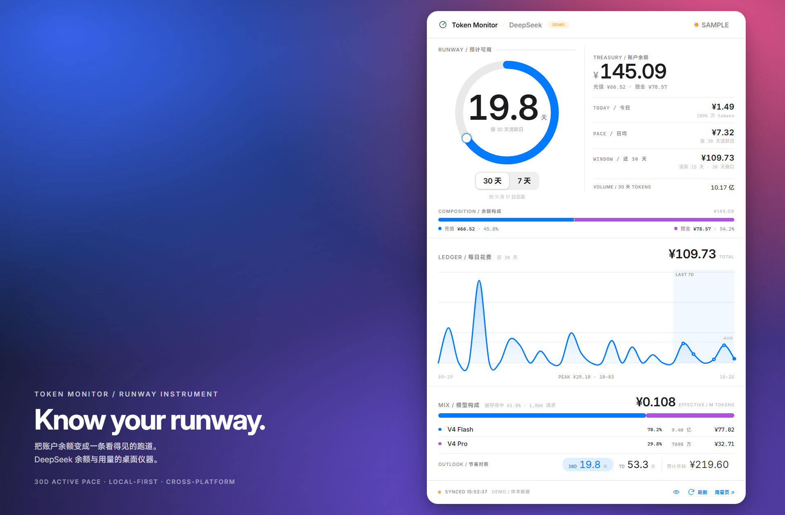
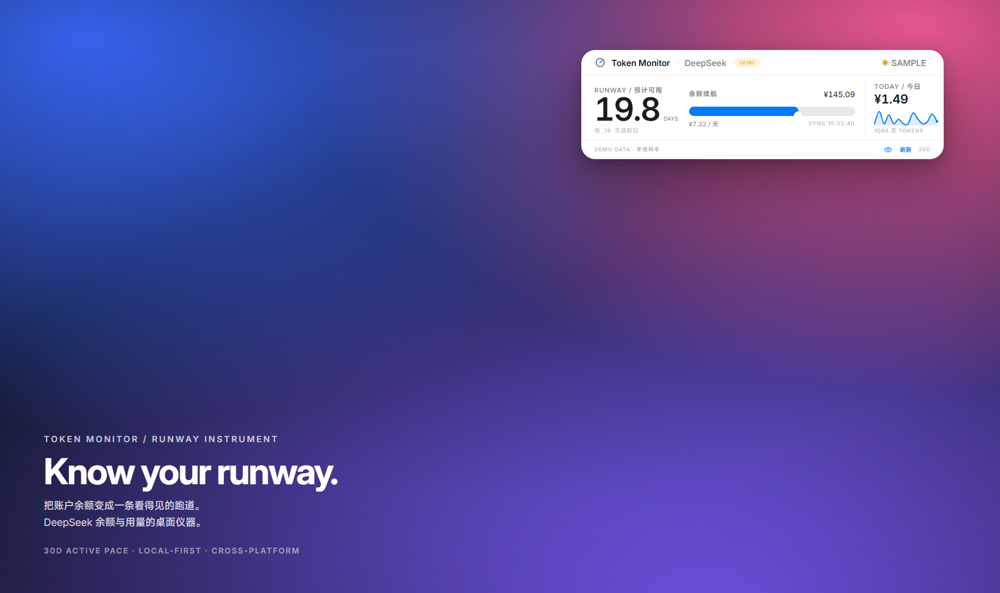
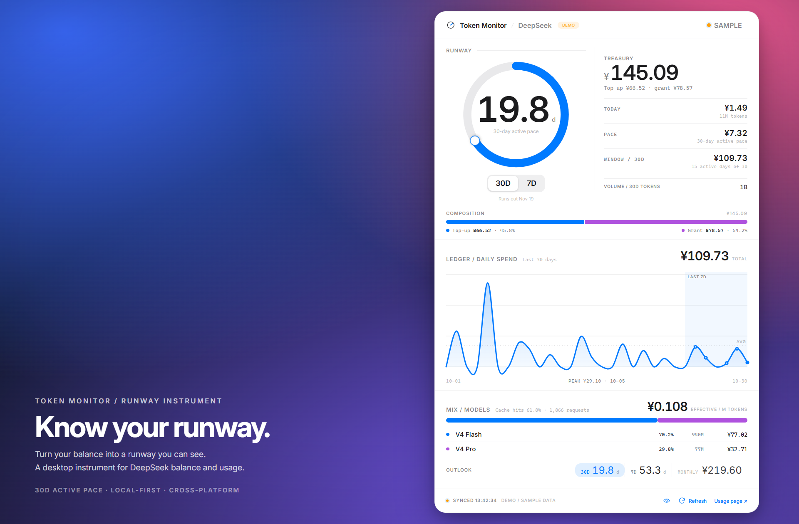
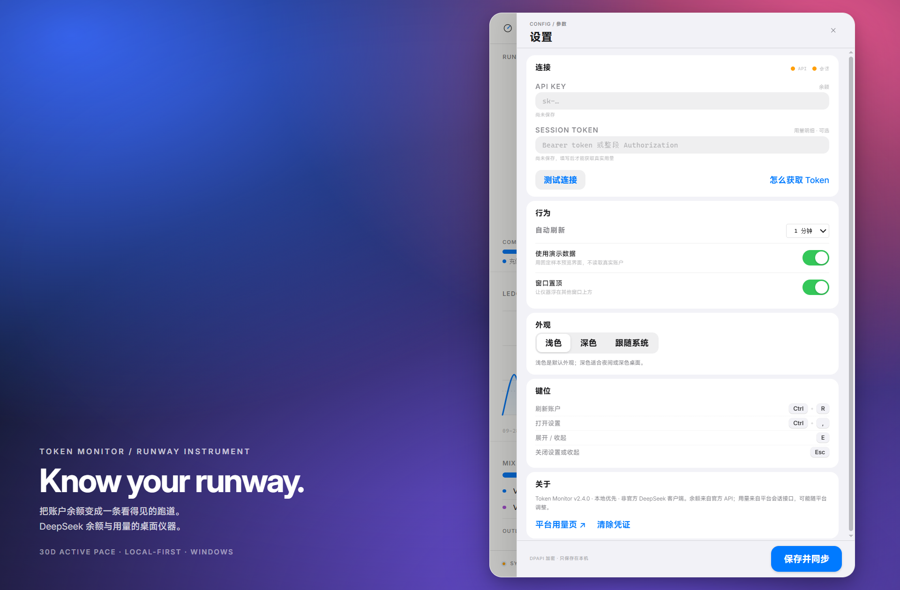
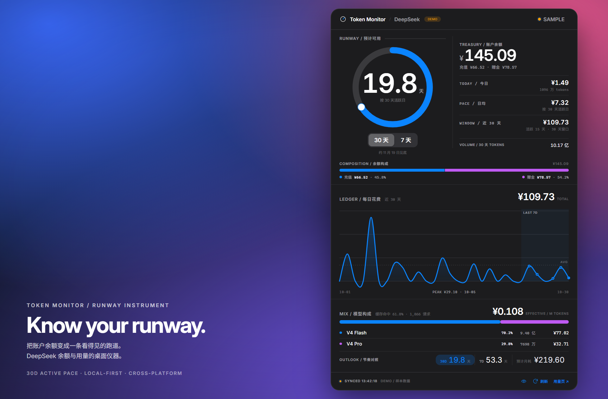
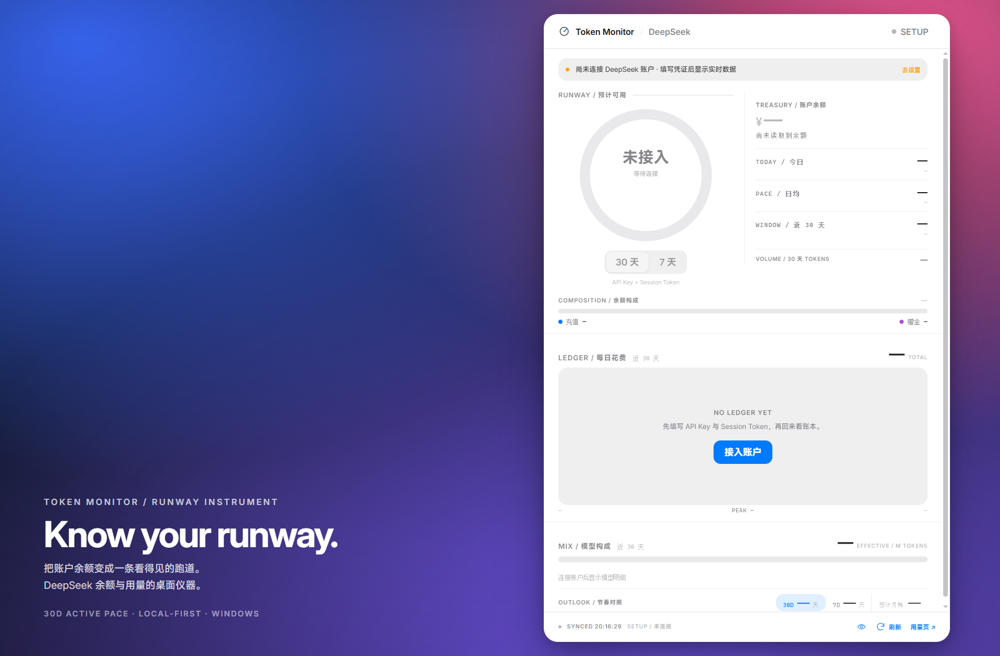
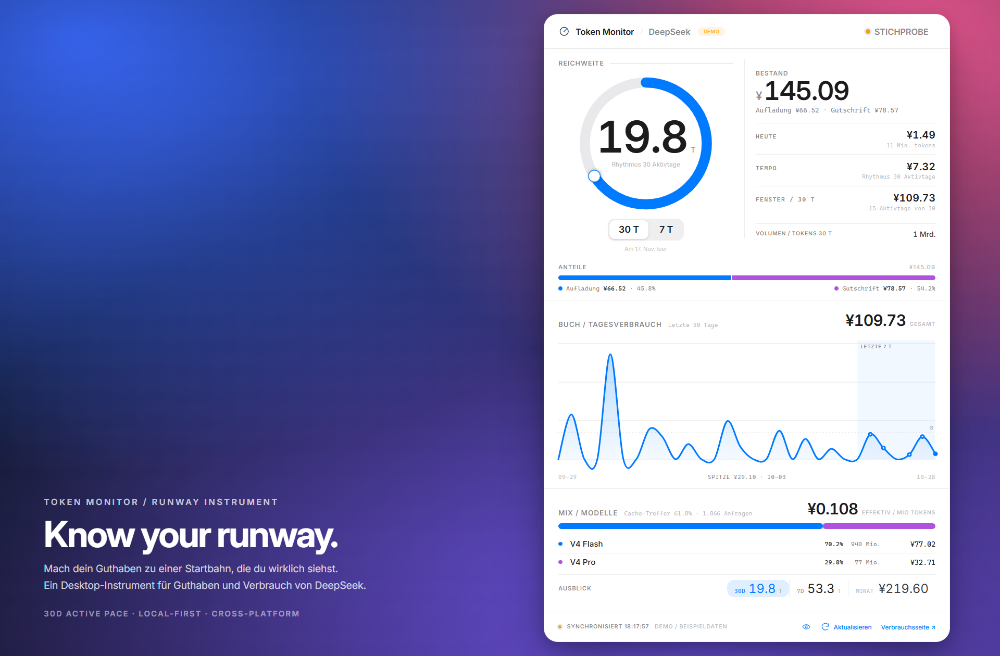
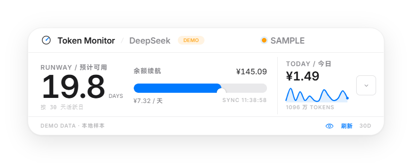
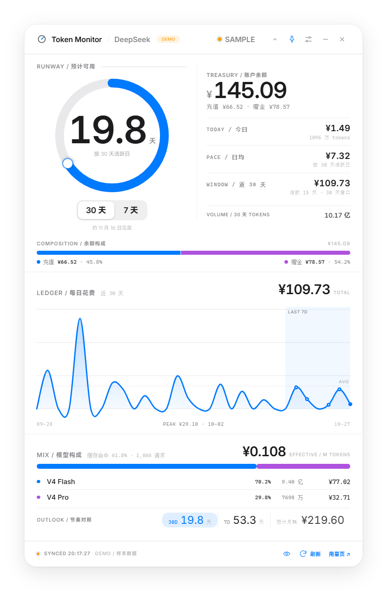

<p align="right"><a href="./README.md">EN</a> | <strong>简体中文</strong> | <a href="./README.es.md">Español</a> | <a href="./README.pt-BR.md">Português</a> | <a href="./README.de.md">Deutsch</a></p>

<div align="center">
    
    <h1>Token Monitor</h1>
    <p><em>Know your runway —— 把 DeepSeek 余额与用量做成桌面仪器。</em></p>
    <p>
        <a href="https://github.com/A-Bullrager/token-monitor/releases"></a>
        
        
        
        <a href="LICENSE"></a>
    </p>
</div>

日常缩成条带，需要时展开账本，用 `30D / 7D` 两种消费节奏估算「还能用多久」。界面提供**中文、英文、西班牙语、巴西葡萄牙语和德语**：默认「自动」按系统语言前缀选择，五种语言也都可以在设置里固定。基于 Electron 45、原生 DOM 与 SVG；无需中转服务器，不做遥测。

## 展示

下面所有图片都跑的是本地演示数据，用来说明界面长什么样，不构成对任何一次测试结果的证明。

<table>
<tr>
<td width="50%" align="center"><br><sub><b>账本</b> —— 跑道仪表、余额、近 30 天花费曲线、模型构成与缓存命中率</sub></td>
<td width="50%" align="center"><br><sub><b>账本（英文）</b> —— 同一界面，英文文案</sub></td>
</tr>
<tr>
<td width="50%" align="center"><br><sub><b>条带</b> —— 日常形态：可用天数、余额、今日花费与迷你曲线</sub></td>
<td width="50%" align="center"><br><sub><b>条带（英文）</b> —— 同一形态，英文文案</sub></td>
</tr>
<tr>
<td width="33%" align="center"><br><sub><b>设置</b> —— 凭证、刷新、主题、语言与快捷键</sub></td>
<td width="33%" align="center"><br><sub><b>深色</b> —— 适合夜间或深色桌面</sub></td>
<td width="33%" align="center"><br><sub><b>未连接</b> —— 填入凭证前是演示数据</sub></td>
</tr>
<tr>
<td width="33%" align="center"><br><sub><b>Español</b> —— <i>Autonomía</i>、<i>Recarga / bono</i>、<i>Se agota 5 mar</i></sub></td>
<td width="33%" align="center"><br><sub><b>Português (Brasil)</b> —— <i>Autonomia</i>、<i>Recarga / bônus</i>、<i>Acaba 5 de mar.</i></sub></td>
<td width="33%" align="center"><br><sub><b>Deutsch</b> —— <i>Reichweite</i>、<i>Aufladung / Gutschrift</i>、<i>Am 5. März leer</i></sub></td>
</tr>
</table>

下面两张来自真实运行窗口而不是摆拍，用来核对真机上的样子与上面一致：

<table>
<tr>
<td width="50%" align="center"><br><sub><b>运行中的条带</b> —— 从实际窗口截取</sub></td>
<td width="50%" align="center"><br><sub><b>运行中的账本</b> —— 从实际窗口截取</sub></td>
</tr>
</table>

## 界面与功能

- **条带 / 账本**：余额、今日消费、双节奏跑道与预计见底日期。
- **用量明细**：近 30 天花费曲线、tokens、模型构成、缓存命中率、请求数与有效单价。
- **桌面交互**：拖动、置顶、系统托盘、形态切换；透明窗口效果依平台而异。
- **显示与隐私**：浅色 / 深色 / 跟随系统，一键隐藏金额；默认提供本地演示数据。
- **同步**：手动刷新，或每 30 秒 / 1 分钟 / 5 分钟刷新。

## 下载与运行

发布后可从 [GitHub Releases](https://github.com/A-Bullrager/token-monitor/releases) 下载；开发构建在 Actions 运行页的 Artifacts 中。
**当前发布的是 [v2.6.0](https://github.com/A-Bullrager/token-monitor/releases/tag/v2.6.0)** —— 五种语言那一版：中文、英文、西班牙语、巴西葡萄牙语、德语。四个原生 runner 全部通过，发布页附了六件程序包与 `SHA256SUMS.txt`。Windows 包已从发布页原件重新下载，哈希与清单一致，并在本机解包启动通过全部断言；Linux 与 macOS 包只由各自 runner 的解包 / 安装校验覆盖，没有在开发者真机上复验。

| 平台 | 程序包 | 使用方式 |
| --- | --- | --- |
| Windows x64 | portable ZIP | 解压整个目录，运行其中的 `Token Monitor.exe`；不要把 exe 单独搬出目录 |
| Linux x64 | AppImage | 赋予可执行权限后，在有图形桌面的环境运行 |
| macOS Apple Silicon | arm64 DMG + ZIP | DMG 内的应用复制到「应用程序」，或解压 ZIP 后使用 |
| macOS Intel | x64 DMG + ZIP | 选择 x64 包，不与 arm64 混用 |

### 平台注意事项

- **macOS**：当前为 ad-hoc 签名（`identity: '-'`），且 `notarize: false`；不是 Developer ID 签名，也未公证。浏览器下载后可能被 Gatekeeper 拦截。
- 下载后先校验发布页的 `SHA256SUMS.txt`。仅在信任来源时，按系统提示到「系统设置 → 隐私与安全」允许打开；若系统不允许，不要强行绕过。校验和不等于开发者身份认证。
- **Linux**：需要图形桌面及 Electron 依赖，如 GTK、NSS、ATK、GBM、ALSA；凭证保护还需要可用的桌面密钥环服务。依赖名称和 FUSE 安装方式请遵循发行版文档。
- GNOME 可能需要 AppIndicator / KStatusNotifierItem 托盘扩展。透明窗口、置顶和托盘行为依桌面、合成器及 Wayland 环境而异，不保证一致。
- 本轮已在 Windows 10 x64 通过源码、便携目录和实际 ZIP 解包启动检查；Linux / macOS 尚未原生运行，不能标为已验证支持。

## 从源码运行

需要 **Node.js ≥ 22.12.0，推荐 Node.js 24**，以及 npm。在仓库根目录执行：

```bash
npm ci
npm start
```

`npm start` 会为子进程移除残留的 `ELECTRON_RUN_AS_NODE`，避免 Electron 退化为无窗口的 Node 模式。

### 本地打包

请在对应平台构建；首次构建前可运行 `npm run icons` 生成打包图标。

| 命令 | 目标与输出 |
| --- | --- |
| `npm run package:dir` | 本机平台与架构的目录版，输出到 `dist/Token Monitor-<platform>-<arch>/` |
| `npm run package:win` | 仅生成 Windows x64 目录版（`dist/`），不压缩 |
| `npm run package:win:zip` | **仅 Windows x64 宿主**；打包目录后压成 `release/token-monitor-<version>-win-x64.zip`，与 CI 使用同一脚本 |
| `npm run package:linux` | Linux x64 AppImage，输出到 `release/` |
| `npm run package:mac` | macOS DMG + ZIP，默认使用宿主架构，输出到 `release/` |

macOS 可显式选择 `npm run package:mac -- --arm64` 或 `npm run package:mac -- --x64`；构建不等于已在目标架构运行验证。
`test:distributable` 需要 `release/` 中实际存在对应程序包，不能用目录版代替；它会先比较归档与源码的修改时间，**比源码旧的程序包直接判失败**——曾经有一次本地「验证通过」其实跑的是上一版代码留下的 ZIP。

## 接入 DeepSeek 账户

1. 打开设置，先确认底部的凭证存储提示。
2. 在 [DeepSeek API Keys](https://platform.deepseek.com/api_keys) 创建 **API Key**，用于官方余额接口。
3. 要获取用量与跑道，登录 [平台用量页](https://platform.deepseek.com/usage)，打开开发者工具的 Network，刷新页面。
4. 在 `api/v0` 请求的 `Authorization` 中复制 `Bearer` 后的 **Session Token**；也可整段粘贴，应用会清理前缀。
5. 关闭「使用演示数据」，保存并同步。Session 过期后需手动更新。

**API Key 只能读取余额。跑道需要余额和 Session Token 提供的用量数据；仅填 API Key 无法计算跑道。**
Session Token 是敏感凭证，不要放进截图、日志、Issue 或公开仓库。

## 指标口径

| 指标 | 算法 / 来源 |
| --- | --- |
| 账户总余额 | 官方 `GET https://api.deepseek.com/user/balance`，优先 CNY 账户 |
| 今日花费 / tokens | 平台按日数据，取本地日历的今天 |
| 近 30 天花费 / tokens | 含今天的 30 个自然日，必要时合并上月数据 |
| 30D 日均 | 近 30 天总消费 ÷ 有消费的活跃日数 |
| 30D 跑道 | 总余额 ÷ 30D 日均 |
| 7D 日均 | 近 7 个自然日总消费 ÷ 7，零消费日也计入 |
| 7D 跑道 | 总余额 ÷ 7D 日均 |
| 见底日期 | 本地今天加上四舍五入后的跑道天数，属于估算 |
| 预计月耗 | 当前所选节奏的日均 × 30 |
| 有效单价 | 近 30 天总费用 ÷ tokens × 1,000,000 |
| 缓存命中率 | `hit ÷ (hit + miss + 普通 prompt/input) × 100%`，按输入 tokens 统计 |
| 请求数 / 模型构成 | 在相同 30 天窗口聚合；模型行提供各模型缓存命中率提示 |

日均为零或缺少必要数据时，不给出有效跑道估计；消费样本偏少会提示「仅供参考」。
平台用量来自未公开的内部接口 `/api/v0/usage/amount` 与 `/api/v0/usage/cost`（域名 `platform.deepseek.com`，按月请求）。
字段、鉴权及数据延迟可能变化；上月请求失败时当前实现继续使用可取得的数据，30 天统计可能不完整。

## 安全与本地配置

凭证经 preload 桥交给主进程，保存后只向界面返回掩码。`safeStorage` 是否可用取决于当前平台和桌面服务：

| 平台 | 可用时采用的保护 |
| --- | --- |
| Windows | DPAPI |
| macOS | Keychain |
| Linux | 真实的 `gnome_libsecret` 或 KWallet（`kwallet` / `kwallet5` / `kwallet6`）后端 |

Linux 的 `basic_text`、`unknown` 及其他不受认可或不可用的后端均按 `none` 处理。
**系统加密不可用时，仍沿用 `plain:` + base64 的落盘回退；这不是加密，能读取配置文件的人可以还原凭证。** UI 会显示「未加密 · 系统加密服务不可用」警告；不接受此方式时请勿保存真实凭证。

**探测是懒加载且异步的。** 可用性检查（`isAsyncEncryptionAvailable`，缺失时才退回同步 API）只在打开设置抽屉时发起，启动路径一律不碰钥匙串——macOS 上钥匙串锁住或等待授权时，同步调用会把主进程整条挂死（首次云端运行正是这样卡住的）。因此：

- 还没得到答案时，存储标签保持中性的「只保存在本机」，既不承诺加密，也不谎报未加密。
- 后端状态未知时提交**新凭证**会被拒绝并提示「系统加密状态未确认，凭证未保存」，不会静默降级成明文；只改主题、节奏、置顶或形态则照常保存。
- 未改动的凭证沿用磁盘上原有的密文，不会因为一次无关的保存被重新加密或降级；`plain:` 旧值只有在确认后端可靠后才会升级为 `enc:`。
- 真实钥匙串仍只在 Windows DPAPI 上做过端到端验证；macOS / Linux 的钥匙串路径未在真机验证过。

日常配置文件位置（不含测试使用的隔离 profile）：

| 平台 | `config.json` 路径 |
| --- | --- |
| Windows | `%APPDATA%\Token Monitor\config.json` |
| macOS | `~/Library/Application Support/Token Monitor/config.json` |
| Linux | `${XDG_CONFIG_HOME:-~/.config}/Token Monitor/config.json` |

设置中凭证留空表示保留旧值；「清除凭证」会清空两项并切回演示模式。
账户请求直接发往 `api.deepseek.com` / `platform.deepseek.com`；没有中转服务器或统计上报。图标、字体与演示数据均为本地资源。

## 语言支持

界面文案以中文撰写，其余每一种语言都是一份**以那条中文原文为键**的词典（`renderer/i18n.js` + `renderer/locales/<语言>.js`），由主进程与渲染层共同加载。不存在两份各说各话的文案：`npm run check:i18n` 会在任何词典缺键、用中文回答、漏掉某个插值句式或忘记单复数时直接失败。

| 中文界面 | 英文界面 |
| --- | --- |
|  |  |

- **提供哪些语言**：中文（撰写语言）、英文、西班牙语、巴西葡萄牙语、德语。「自动」按系统语言前缀匹配 `zh*` / `es*` / `pt*` / `de*` / `en*`，其余语言落到英文——它是随包字体无需系统字体就能渲染的那一种。`pt-PT` 因此使用巴西词典，`es-MX` 与 `es-ES` 共用同一份西班牙语。
- **翻什么**：两种形态、设置抽屉、快捷键表、通知与错误提示、托盘菜单与提示、macOS 应用菜单，以及那些连中文界面也显示成英文的仪器标签（`DAYS`、`TOTAL`、`SAMPLE`、`AVG`、`PEAK ¥29.10 · 10-03`、`SYNCED 18:02:18`）。
- **不翻什么**：产品名、`Know your runway.` 这句标语、`DeepSeek`、作为字段名的 `API KEY` / `SESSION TOKEN`，以及仪器码 `DEMO`、`SYNC`、`30D / 7D` 和数量级单位 `M` / `K`。
- **数字与日期随语言走**：中文用 `万 / 亿` 分组、见底写作 `约 3 月 5 日见底`；英文 `12.5K` 与 `Runs out Mar 5`；西班牙语 `12,5 mil` 与 `Se agota 5 mar`；葡萄牙语 `12,5 mil` 与 `Acaba 5 de mar.`；德语 `12.500` 与 `Am 5. März leer`。它们描述的是同一个量，检查按数值比较而不是字符串。一个值长过给它留的格子时——为 ¥1.49 排版的列里放 ¥99,999,999.99，或者一条德语小标签比英文宽出 4 像素——它会自己缩小字号直到装得下，而不是被切掉。
- **单复数属于语言**：中文不标记语法数量，所以每种语言各自变化被计数的名词（`1 día activo` / `15 días activos`、`1 Tag` / `15 Tage`）。一致性检查会拒绝「单数与复数长得一样」的词典，并把测量值 `1.0` 视为复数。
- **已知边界**：金额在任何语言都保持同一套小数点写法（`¥145.09`），时钟同理；只有 token 数量按语言自身的分组习惯显示。切换语言会保存设置并**重新加载窗口**——这是唯一会触发重载的选项，因为已经写进页面的文字无法就地再翻译一遍。

**一个真实的字体约束**：随应用打包的是裁剪过的字体子集。MiSans 子集按固定语料裁剪，里面**没有** 语 / 言 / 英 / 文 四个字，因此新中文文案必须落回 `scripts/font-corpus.txt`——语言行也因此用 ASCII 的 `LANGUAGE`，中文选项写作 `Chinese` 而不是 `中文`。新语言需要的变音字母（`Á Ã Ç É Í Ó Ø Ú Ü ß á ã ä ç é ê í ñ ó ô õ ö ú ü`）已用 fontTools 对照 Inter 子集的真实 cmap 逐个核对；`scripts/glyph-demand.mjs` 会在任何窗口打开之前，因词典索取语料之外的字符而失败。`npm run test:i18n` 再对屏幕上真正出现的字符复核一次语料归属——这条检查曾经抓到真问题：等宽标签在 Linux runner 上显示方框，因为字体栈缺少随应用打包的中文回退。

## 测试与验证范围

**本地验证（Windows 10 x64）：** 数据测试、22 组模拟存储后端断言、词典一致性、字形需求检查、源码 UI、便携目录和实际 ZIP 解包启动均通过；16 个语言场景 × 4 个界面状态全部通过，翻译模式下屏幕上的中文字符数为 0，采集字符均在语料内，没有任何一种语言的标签被裁掉；数字适配 10 组 × 10 档数量级也没有一个数字越出盒子。另用 fontTools 对照真实子集 cmap：词典能放上屏幕的拉丁字符都在 Inter 子集里，需求集里的汉字至少命中一个随包字体。

**云端共十三轮，当前发布版本在四个原生 runner 上全绿。** 逐轮过程折叠在下面；折叠里只放过程叙述，能被证明「不成立」的结论一律留在折叠外面。其中一条负面结论是关于测试本身的：形变检查在 macOS 上是瞎的——窗口边缘动的时候，它采样依据的 CSS 类早已移除（第十二轮），所以现在改为按实际观测到的运动评级。

<details>
<summary>云端构建记录（第 1–13 轮）</summary>

**云端第一轮（`9faa78e`，四个原生 runner）：** Windows x64 全绿；Linux x64 在 `ar-SA` 场景把「退出时调试连接先于回复关闭」误判为失败；两个 macOS 架构打包与严格验签成功，但发布物启动校验在首个 CDP 往返超时。

**云端第二轮（`4fb1d4d`）：** Windows x64 仍全绿；Linux 语言测试转绿，失败点变成打包文件名——electron-builder 实际产出 `linux-x86_64.AppImage`，与验包脚本和 Release 契约要求的 `linux-x64` 不一致；两个 macOS 架构仍在同一处超时，但这次带回了进程栈证据：主线程 80/80 次采样停在 `SecItemCopyMatching → SecurityServer → mach_msg`，即启动路径上的**同步钥匙串读取**把主进程整条挂死（源码测试用未签名 Electron，其钥匙串条目在 runner 上已授权，所以只有打包应用会撞上）。

**据此做的修复：** 退出竞态只放行该一种情况且仍要求进程以 0 退出；等宽标签补上打包的 MiSans 回退并用 CDP 校验真实生效字体；Linux 产物名固定为 `linux-x64`；钥匙串探测改为「打开设置时异步发起」，启动路径不再触碰（见「安全与本地配置」）。

**云端第三轮（`de0c757`）：** Windows x64、Linux x64（AppImage 解包后真实启动）、macOS Apple Silicon（DMG + ZIP 构建、严格验签、ZIP 解包与 DMG 复制安装后启动校验）三组全绿；macOS Intel 只在生成 DMG 时失败——`dmgbuild` 收尾的 `hdiutil detach` 撞上「Resource busy」，同一步的 ZIP 已经产出，同配置的 arm64 在同一提交上通过，属于 runner 上的竞态而非打包配置错误，因此给该步骤加了最多三次、只清理自己卷标的有界重试。

**云端第四轮（`036e326`，四组全绿）：** Intel 那次竞态确实复现了，重试机制在第二次尝试时把 DMG 构建救回来（日志留有一条 detach 重试提示），随后 ZIP 解包与 DMG 复制安装两条路径都通过；四个 runner 各自上传了程序包 Artifacts。

**云端第五轮（`v2.4.1` 标签，run 40642992704）：** 单独推标签后 tag 流水线如期触发，四个 runner 全绿，Release job 校验六件程序包、生成 `SHA256SUMS.txt` 并发布。从发布页重新下载的 Windows 包 SHA256 与清单一致，并在本机解包启动通过全部断言（`isPackaged`、`v2.4.1`、启动不探测钥匙串、设置抽屉显示 DPAPI）。Linux 与 macOS 的包只经过各自 runner 的解包 / 安装校验，没有在开发者的真机上复验。

**双语第一版（`1cedcc6`）在四个 runner 上同时失败**：断言写的是中文文案，而 runner 宿主语言是英语，`auto` 解析出了英文界面。产品行为是对的，测试假设是错的——修复方式是让回归显式钉住自己要断言的语言（见上表 `test:ui`），只保留"切英文后重启"那一步不钉。

**双语第二版（`d62fc57`，四组全绿）：** 英文宿主的 Linux 与 macOS runner 上，11 个语言 / 时区场景、UI 回归、AppImage 与 DMG + ZIP 的解包 / 安装启动校验全部通过；`2.5.0` 的三个平台程序包均已产出。

**云端第八轮（`v2.5.0` 标签，run 40660748693）：** 单独推标签如期触发 tag 流水线，四个 runner 全绿，Release job 校验六件程序包、生成 `SHA256SUMS.txt` 并发布。从发布页重新下载的 Windows 包 SHA256 与清单一致，并在本机走了解包启动与全部断言；Linux 与 macOS 包只有各自 runner 的覆盖。


**云端第九轮（`5a21201`，首个五语言提交）只在 macOS 失败**：新加的「标签是否被裁切」断言报告**英文**的节奏行在 macOS Apple Silicon 上超出盒子 12 像素，而同一份构建在 Windows 与 Linux 都正常——这一行的宽度当初是照着写它那台机器的字体量出来的。而且检查遇到第一个失败场景就抛出，所以一轮只能暴露一个平台的第一个问题。
**云端第十轮（`819601e`，四个全绿）**：裁切检查改为收集全部场景与状态后一次性报出，英文措辞也改成 `15 active days of 30`——说的是同一件事，字符更少，而更少几个字符正是「一个标签」和「一个被切掉的标签」的差别。
**云端第十一轮（`v2.6.0` 标签，run 40801968504）**：单独推标签触发 tag 流水线，四个 runner 全绿，Release job 校验六件程序包、生成 `SHA256SUMS.txt` 并发布。从发布页重新下载的 Windows 包 SHA256 与清单一致，并在本机走了解包启动与全部断言（`isPackaged`、版本 2.6.0）；Linux 与 macOS 包只有各自 runner 的覆盖。

**云端第十二轮（`a244fa4`，只改文档）又在 macOS 失败——问题在测试而不是产品**：形变检查在 Apple Silicon 上报 `596 -> 593`，而同一份代码一轮 CI 之前刚在这台 runner 上全绿。原因是采样跟着它监听的那个 CSS 类结束，而 macOS 按自己的节奏应用 `setSize`：机器一忙，窗口边缘就动在类消失之后。测量是瞎的，动画确实发生了。

**云端第十三轮（`c52a77e`，四个全绿）**：形变改为按窗口边缘真正在动的那些帧评级，每次运行最多记录三次采样。用真跳变验证过：把形变时长强制成 1ms，检查就会以 "biggest single step 668px of 668px" 失败。
</details>

**macOS 钥匙串在 CI 的真实结论：** 源码运行探测到 `keychain`（未签名 Electron 的条目在 runner 上已授权），而**打包应用始终停在 `pending`**——系统不回答。现在的检查把这作为已报告的结果接受（应用照常启动、渲染、通过全部界面断言），不再因此挂死；但这意味着**打包版 macOS 的真实钥匙串加密仍未被任何环境验证过**，README 不把它当作已验证。

| 命令 | 检查范围 |
| --- | --- |
| `npm test` | 依次运行数据、存储、UI、语言环境测试 |
| `npm run check:release` | 版本号一致性门禁：`package.json` / 锁文件 / 渲染层两处字面量必须同版本，标签必须等于 `v` + 版本 |
| `npm run check:i18n` | 各语言词典的一致性门禁：键集合相同、插值句式相同、不许用中文回答、单数与复数必须不同形；外加对照 `scripts/font-corpus.txt` 的字形需求检查 |
| `npm run check:docs` | 五份 README 的同构门禁：每份都要链到其他四种语言并标出自己为当前语言，章节结构一致、截图集合一致、markdown / HTML / 跨语言链接无死链、`<details>` 成对 |
| `npm run test:parse` | 数据解析、聚合、双节奏与边界情况，无需图形界面 |
| `npm run test:store` | 22 组模拟系统后端断言：懒探测、pending 拒写、密文沿用、`plain:` 升级，以及「可保存的语言必须等于随包词典」；不代替真实密钥环验证 |
| `npm run test:ui` | 形态、主题、隐私、设置、凭证存储分支与清除、重启还原、形变采样，切换英文后重载并再次启动仍是英文，以及依次切到西班牙语 / 葡萄牙语 / 德语的完整回路：窗口必须重载、重新打开设置时选中的语言要重新高亮。形变按窗口边缘真正在动的那些帧评级，最多取三次采样且每次都记录——需要重试才通过是关于 runner 的证据，不是被藏起来的第二次机会。除刻意不固定的那几步外都显式固定中文，否则宿主语言一变断言就跟着漂（CI runner 的宿主语言是英语，第一版就在这里全线失败） |
| `npm run test:i18n` | 下述 Chromium 语言 / 时区、界面语言解析、翻译完整性、字体与标签溢出检查 |
| `npm run test:numbers` | 把十档数量级——从 ¥0.01 与 7 个 token，到 ¥99,999,999.99 余额、1.096 亿 token、`999+` 跑道和超长模型名——灌进五种语言、两种形态的真实渲染路径，只要有一个数字越出给它留的盒子就失败。它刻意跑在真实窗口里：摆拍模式把卡片铺在更宽的营销画布上，这个检查的第一版就在那儿测，结果漏掉了一处真实的 5 像素溢出 它也记录了这套仪器在哪里停住：当日花费到 ¥99,999,999,999.99 时，条带的「今日」是唯一一个字号缩到下限仍装不下的格子（五种语言都超 32px），而账本仍完整显示——检查把这一点原样断言下来，所以在极端档位上多坏掉任何一个格子都仍然会失败。 |
| `npm run test:packaged` | `dist/` 目录版启动、字体、版本和形态还原 |
| `npm run test:distributable` | 从 `release/` 的实际 ZIP / DMG / AppImage 解包并启动其中的可执行文件，不回退到 `dist/` |
`npm run shots` 只更新 5 张演示态展示图；各语言那几张（`deck-en`、`deck-es`、`deck-pt-BR`、`deck-de`、`strip-en`）要用 `node scripts/launch.mjs --shot=<名字> --locale=<语言>` 生成

回归使用隔离配置目录和演示数据；凭证错误路径会尝试用无效测试 Key 请求 DeepSeek，可接受鉴权或网络失败，不是完全离线测试，也不是有效真实账户的正样本验证。
形变（morph）的亮度代理指标是 `min(每帧 max(条带 opacity, 账本 opacity))`，不是两层 opacity 之和；该采样也不证明所有环境都无重影。

### 语言环境与字体检查

`test:i18n` 共启动 **16 次**：

- 请求十一种 Chromium 语言：`zh-CN`、`en-US`、`es-ES`、`es-MX`、`pt-BR`、`pt-PT`、`de-DE`、`ja-JP`、`fr-FR`、`ko-KR`、`ar-SA`。Chromium 会规范化其中一些（`ja-JP` → `ja`，`es-MX` → 中性的 `es-419`），报告同时保留请求值和实际值。每个场景都断言**应用解析出了哪种界面语言**：`zh*` 保持中文，`es*` / `pt*` / `de*` / `en*` 用各自词典，没有词典的语言（日语、法语、韩语、阿拉伯语）落到英文。任何翻译模式下都要求屏幕上不残留中文、且词典没有报告未翻条目。
- 另两次通过 CDP 模拟 Chromium 时区：`Pacific/Kiritimati`（UTC+14）与 `Pacific/Niue`（UTC−11），不改变宿主或主进程时区。
- 再加三次手动覆盖：在 `zh-CN` 下强制英文、在 `en-US` 下强制中文、在 `de-DE` 下强制西班牙语，验证选择器能压过浏览器语言——这正是设置里那个选项做的事。
- 每次使用独立、含中文与空格的 profile，检查配置落盘；遍历浅色条带、浅色账本、设置、深色账本四个状态。
- 余额、跑道、今日花费与 `zh-CN` 基准逐字符串比较；tokens 按数值比较，并按每种语言自己的分组习惯解析（`1096 万`、`11M`、`11 M`、`11 Mio.`）；不要求时钟、日期与日期相关标签相同。
- 检查 Inter / MiSans 的 FontFace 状态：中文模式下两者都必须已加载，翻译模式下 MiSans 允许保持 `unloaded`（屏幕没有中文，浏览器按需加载本就不取它，这不是缺陷）；采集的 DOM 字符必须属于 `scripts/font-corpus.txt`；中文模式还通过 CDP `CSS.getPlatformFontsForNode` 读取「会话」标签实际命中的平台字体，确认它使用打包的 MiSans 子集（Windows 实测：修复前落到系统 NSimSun，Linux runner 上直接显示方框）。
- **每个可见标签都会与自己的盒子尺寸比对**（`scrollWidth` 与最近的裁剪祖先），因为语言变长时文字明明翻译正确、却被切掉一半，而字符类检查完全看不见这一点。它会一次性报告所有场景而不是在第一个就停下——字体度量按操作系统不同：同一行在 Windows 与 Linux 都装得下，在 macOS 上却溢出 12 像素，英文措辞正是这样被发现并改短的。

这些检查**不证明字体 cmap 完整覆盖、所有 fallback 字形、原生菜单、其他宿主 OS 语言版本或真实密钥加密**；语言测试本身不填写凭证，也不做加解密往返。
token 数量的分组与紧凑记数按语言走（`1096 万` / `11M` / `11 M` / `11 Mio.`），金额与时钟仍统一用点号小数和 24 小时制。

## GitHub Actions 与发布

工作流见 [`.github/workflows/build.yml`](.github/workflows/build.yml)。四个 runner 都跑过真实构建，Release 路径也已经发布过三次——v2.4.1、v2.5.0、v2.6.0。
本地 `git commit` 不会触发云端任务；需要 push、PR 或手动触发。GitHub Packages 面向 npm / 容器等包仓库，本项目的桌面程序使用 Artifacts 和 Release 附件分发。

| 触发方式 | 行为 |
| --- | --- |
| 向 `main` push / 面向 `main` 的 PR | 测试、打包、验证发布物，上传 Artifacts，不创建 Release |
| 手动 `workflow_dispatch` | 同样测试与打包，不创建 Release |
| push `v*` tag | tag 必须严格等于 `v` + `package.json` 的版本，四个 runner 全部成功后才发布 Release |

四个 runner 为 `windows-2022` x64、`ubuntu-22.04` x64、`macos-15` arm64、`macos-15-intel` x64，使用 Node.js 24。
每个 build job 的第一步同时跑 `npm run check:release` 与 `npm run check:docs`：宿主架构必须与 matrix 相符，版本号四处一致，标签场景还要满足 tag == `v` + `package.json` 版本，五份文档必须继续同构。release job 两者都不跑，因为四个 build job 在上传之前已经检查过同一件事。
Linux UI 在 Xvfb + Openbox 虚拟 X11 桌面运行，不代表 GNOME / Wayland 等实际桌面均已验证。
macOS 打包步骤对 `dmgbuild` 的 `hdiutil detach` 竞态最多允许三次尝试（含首次），且只卸载卷名为 `Token Monitor*` 的挂载点；三次用尽即失败，不会静默放过真实打包错误。
发布物启动校验接受 `pending`（系统未回答钥匙串）作为一种已报告状态并继续跑完其余断言，但会在结果里显式记录，不当作加密已验证。
程序包 Artifacts 保留 **14 天**，测试诊断保留 7 天；下载 Artifacts 后可能还需解开外层归档。

Release 需包含六件程序包及 `SHA256SUMS.txt`，文件前缀为 `token-monitor-<version>-`：

- `win-x64.zip`、`linux-x64.AppImage`
- `mac-arm64.dmg`、`mac-arm64.zip`
- `mac-x64.dmg`、`mac-x64.zip`

tag 带 `-`（例如 `v2.7.0-beta.1`）会标为预发布；普通版本 tag 发布正式版。已有公开 Release 不应覆盖，请使用新版本。

### 发布步骤

1. Actions 已在本仓库启用，四个托管 runner 与发布权限均已实际跑通过一次以上。
2. 工作流必须先存在于**默认分支**，Actions 页才可手动运行它；选择 **Build desktop apps → Run workflow**。
3. 无需配置 PAT：Release job 已声明 `contents: write`，使用自带的 `GITHUB_TOKEN`；组织策略仍可能限制执行或授权。
4. 用户明确确认后才提交 / 推送。云端结果以实际运行为准，不把本地修改当作已上线。

git push origin v2.6.0        # 第二步：单独推 tag，才会触发 Release 流程

```bash
git push origin main          # 第一步：让四个 runner 先在新提交上跑绿
git push origin v2.4.1        # 第二步：单独推 tag，才会触发 Release 流程
```

tag 必须等于 `v` + `package.json` 的 `version`，且四个 runner 全部成功；已有公开 Release 不会被覆盖。
GitHub 官方文档：[托管 runners](https://docs.github.com/en/actions/using-github-hosted-runners/about-github-hosted-runners) · [Artifacts](https://docs.github.com/en/actions/using-workflows/storing-workflow-data-as-artifacts) · [触发事件](https://docs.github.com/en/actions/using-workflows/events-that-trigger-workflows)。

## 项目结构与限制

- `main.js` / `preload.js`：窗口、托盘、IPC 与最小化桥接。
- `lib/deepseek.js` / `lib/store.js`：账户接口、指标聚合与配置存储。
- `renderer/`：界面、样式、图表、本地字体与中英共用词典 `i18n.js`；`scripts/`：启动、打包与回归。
- `shots/`：展示与运行截图；`dist/` 为目录版，`release/` 为可分发程序包。

仅支持 DeepSeek，不做多平台聚合、多设备同步、自动登录、开机自启或自动更新。
演示数据不代表真实账户；费用与用量依赖平台返回值及本地日期，预测不能当作消费承诺。

## 参考与许可

参考项目：[token-monitor](https://github.com/Javis603/token-monitor)、[agent-sessions](https://github.com/jazzyalex/agent-sessions)、[CodexBar](https://github.com/steipete/CodexBar)。

项目代码采用 [MIT](LICENSE)。字体遵循各自许可，不由项目 MIT 许可覆盖：

- **Inter**：rsms 提供，采用 SIL OFL 1.1；使用、子集化与再分发须保留许可及版权声明，见 [OFL-Inter.txt](renderer/assets/font/licenses/OFL-Inter.txt)。
- **MiSans**：由小米提供，字形由汉仪制作；本项目使用子集并保留 README、应用「设置 → 关于」及 [MiSans-Notice.txt](renderer/assets/font/licenses/MiSans-Notice.txt) 中的署名。
- MiSans 的子集化与公开再分发是否符合许可，仍需核对[官方协议与下载页](https://hyperos.mi.com/font/download)及具体用途。保留署名、未改字形或仅随应用分发，都**不能保证已完全解决授权问题**；以官方协议原文为准。
